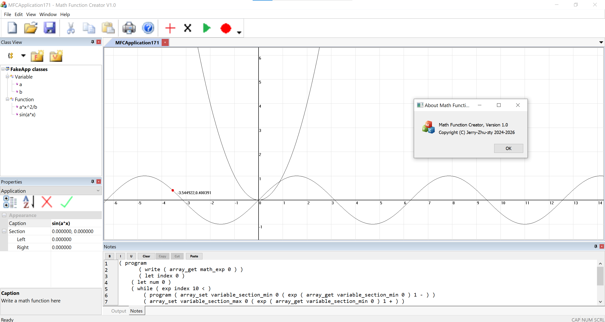
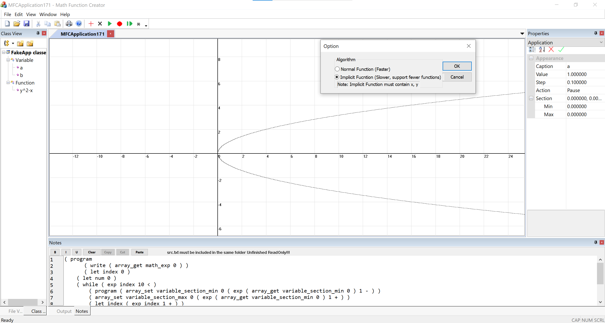
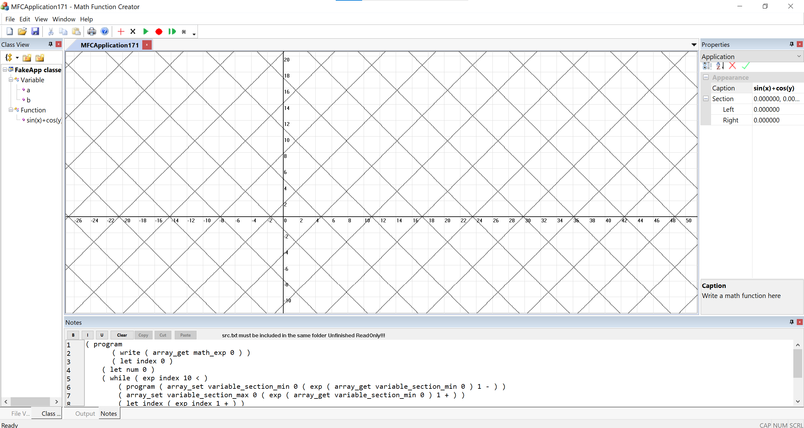
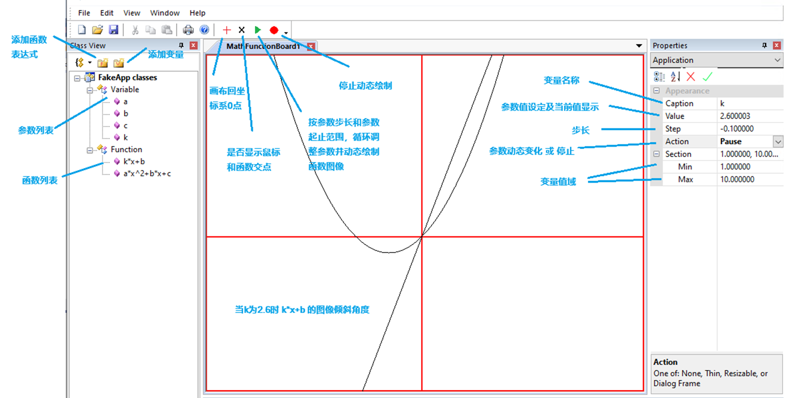

# Math Function Creator

[中文版](README_ZH.md)

> A mathematical function visualization application.

## Features

- [x] Plot basic mathematical functions
- [x] Plot implicit functions
- [x] Create animations by changing the step size through variables
- [x] Built-in script engine [miniscript](https://github.com/Jerry-Zhu-zty/Mini-script) for customizable function animations
- [ ] File saving

## Screenshots






---

## Project Structure

```text
MFCApplication17/
  ├── ChildFrm.cpp / .h           # Child frame
  ├── MainFrm.cpp / .h            # Main frame
  ├── MFCApplication17.cpp        # Application entry point
  ├── MFCApplication17Doc.cpp     # Document class
  ├── MFCApplication17View.cpp    # View class
  ├── Script.cpp / .h             # Script engine implementation
  ├── Coordinate.cpp / .h         # Coordinate and plotting logic
  ├── MathExpression.cpp / .h     # Mathematical expression processing
  ├── Variable.cpp / .h           # Variable management
  ├── Resource files              # Icons, menus, and dialog resources
  └── res/                        # Resource directory
```

---

## How to Run

- On Windows, run the application by opening the `.exe` file.

## How to Build

### Requirements

- Windows 7 or later
- Visual Studio 2019 or later
- The Desktop development with C++ workload
- C++ MFC for x64/x86 components

### Build Steps

1. Open the solution file:
   - `MFCApplication17.sln`
2. Select an appropriate configuration, such as Debug / x64.
3. Build the solution.
4. Run the generated executable.

---

## License

GPL-2.0 with an exception for Microsoft Foundation Classes
